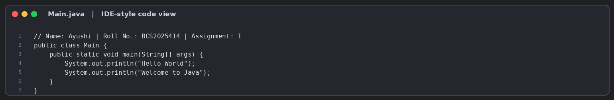
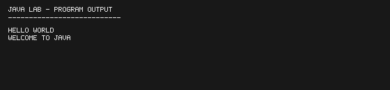
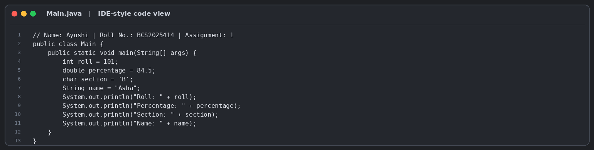
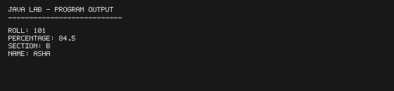
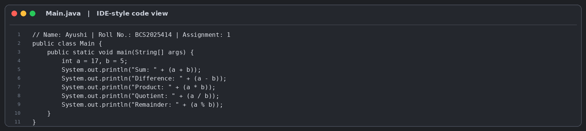
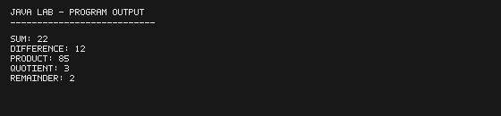
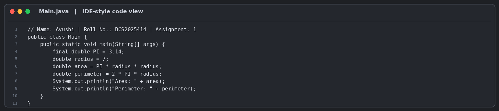
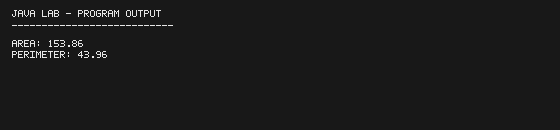

# Assignment 1: Hello World, Variables and Arithmetic

## 1. Experiment Title
Hello World, Variables and Arithmetic

## 2. Aim
Print text, store values in variables and calculate with arithmetic operators.

## 3. Software / Tools Required
- Java Development Kit (JDK)
- IntelliJ IDEA (IDE shown in the supplied reference screenshot)
- Git and GitHub

## 4. Theory
Java is an object-oriented programming language. This experiment introduces the main method, console output, primitive and reference variables, constants, and arithmetic operators.

## 5. Algorithm / Procedure
### Question 1
Print Hello World and Welcome to Java on separate lines.
1. Print the first required message with println, then print the second message with println.

### Question 2
Declare and print roll, percentage, section and name variables.
1. Declare the four variables with their specified data types and values. Print them in the requested label order.

### Question 3
Perform arithmetic operations on a = 17 and b = 5.
1. Initialize a and b. Apply +, -, *, / and % and print each result with its label.

### Question 4
Calculate circle area and perimeter using final PI = 3.14 and radius 7.
1. Declare PI as final, set radius to 7, calculate PI × r × r and 2 × PI × r, then print both.

## 6. Input
### Question 1
No runtime input is required. Values are initialized in the program as specified in the lab sheet.

### Question 2
No runtime input is required. Values are initialized in the program as specified in the lab sheet.

### Question 3
No runtime input is required. Values are initialized in the program as specified in the lab sheet.

### Question 4
No runtime input is required. Values are initialized in the program as specified in the lab sheet.

## 7. Output
### Question 1
```text
Hello World
Welcome to Java
```

### Question 2
```text
Roll: 101
Percentage: 84.5
Section: B
Name: Asha
```

### Question 3
```text
Sum: 22
Difference: 12
Product: 85
Quotient: 3
Remainder: 2
```

### Question 4
```text
Area: 153.86
Perimeter: 43.96
```

## 8. Result
All four programs were compiled and executed. The outputs match the expected sample results in the lab assignment.


## Code and Output Previews

### Question 1





### Question 2





### Question 3





### Question 4





